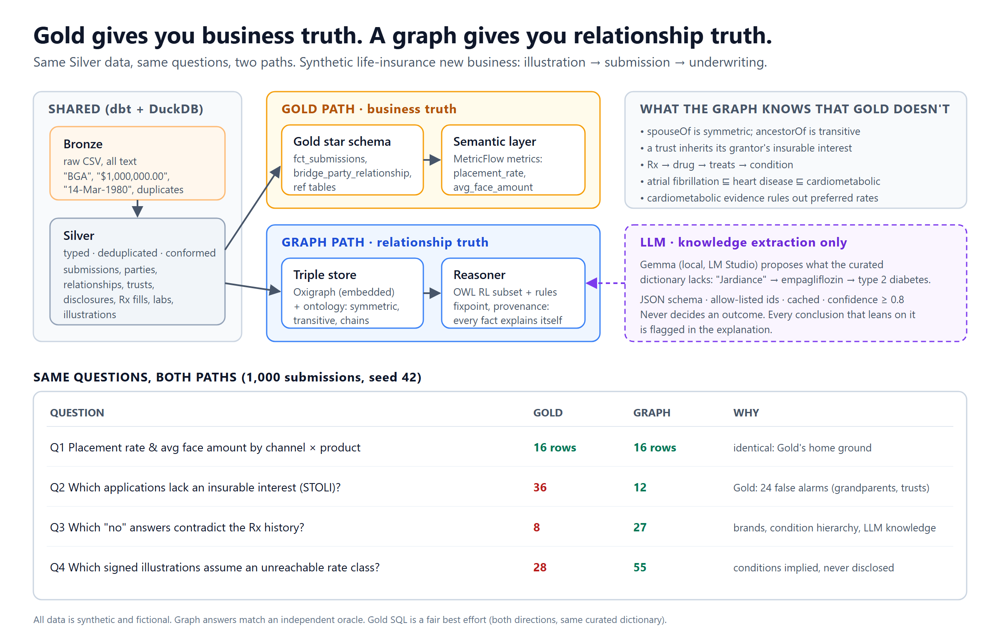

# Semantic to Reasoning

> A Gold layer with a semantic layer gives you **business truth**.
> Only a triple store gives you **relationship truth**, and with it, **reasoning**.

This POC builds both paths on the same synthetic life-insurance data (illustration → submission →
underwriting) and asks them the same four questions.

- **Gold path**: Bronze → Silver → Gold with **dbt + DuckDB**, and a **MetricFlow** semantic layer.
- **Graph path**: the same Silver tables projected to RDF in **Oxigraph**, an OWL ontology, and a
  small Rust **reasoner** that derives new facts and explains every one of them.
- **LLM (optional)**: a local **Gemma** model in LM Studio proposes knowledge the curated
  dictionary lacks. Its output is validated, cached and gated by a trust policy. It never decides
  an outcome.



## Results (1,000 submissions, seed 42, LLM knowledge from Gemma 4 31B)

| | Question | Gold | Graph | What happened |
|---|---|---:|---:|---|
| Q1 | Placement rate and average face amount by channel × product | 16 rows | 16 rows | Identical. This is Gold's home ground. |
| Q2 | Which applications lack an insurable interest (possible STOLI)? | 36 | **12** | Gold raises 24 false alarms: grandparents (two hops) and trusts (owner → grantor → spouse) |
| Q3 | Which "no" answers contradict the prescription history? | 8 | **27** | Gold misses brand names, the condition hierarchy, and drugs only the LLM could map |
| Q4 | Which signed illustrations assume a rate class the case cannot get? | 28 | **55** | Gold misses conditions that are implied by prescriptions but never disclosed |

The graph's answers match an independent oracle written into the data generator. The Gold SQL is
a fair best effort: it checks relationships in both directions and uses the same curated drug
dictionary. Every file in [app/queries/gold](app/queries/gold) says what it cannot see.

Could SQL answer Q2–Q4? Yes, with a recursive CTE per relationship pattern, a hierarchy table and
an alias table, one question at a time. At that point you have rebuilt a graph in SQL, with no
place to state what a relationship *means* and no way to explain an answer.

## Every inference explains itself

```text
$ s2r explain S000177
ex:submission/S000177 uw:hasFinding uw:RequiresReillustration   <= UW-REILL-PREFERRED — The signed illustration assumes a preferred class the case cannot get.
  ├─ ex:illustration/S000177 uw:assumedRateClass rc:PreferredNT   [silver.illustrations]
  ├─ rc:PreferredNT uw:preferredTier true   [ontology]
  └─ ex:submission/S000177 uw:hasFinding uw:PreferredIneligible   <= UW-PREFERRED-INELIGIBLE
     └─ ex:party/P000201 uw:hasConditionEvidence cond:CardiometabolicCondition   <= OWL-CHAIN
        ├─ ex:party/P000201 uw:indicatedCondition cond:AtrialFibrillation   <= OWL-CHAIN hasPrescription ∘ prescribedDrug ∘ treats
        │  ├─ ex:party/P000201 uw:hasPrescription ex:rx/R000018   [silver.rx_fills]
        │  ├─ ex:rx/R000018 uw:prescribedDrug drug:apixaban   [LLM candidate (google/gemma-4-31b, confidence 1.00)]
        │  └─ drug:apixaban uw:treats cond:AtrialFibrillation   [LLM candidate (google/gemma-4-31b, confidence 0.90)]
        └─ cond:AtrialFibrillation uw:subConditionOf cond:CardiometabolicCondition   <= OWL-TRANSITIVE
!! This conclusion depends on an LLM candidate.
```

(Abridged.) The applicant answered "no" to heart disease. The pharmacy feed says "ELIQUIS 5MG".
Gold has both rows. What it does not have is the meaning that connects them.

## Design highlights

- **Same inputs**: both paths read the same Silver tables, so every difference comes from what
  each path can represent.
- **OWL RL subset compiled to rules**: subClassOf, subPropertyOf, inverseOf, symmetric,
  transitive, and property chains, plus business rules in [TOML](app/rules/underwriting.toml).
  Evaluated to a fixpoint with SPARQL (6 iterations, under a second).
- **Stratified negation**: "no insurable interest could be established" is a closed-world check
  that runs only after everything derivable has been derived.
- **Provenance on every inferred triple**, down to `silver.<table>`, `ontology`,
  `curated dictionary` or `LLM candidate (model, confidence)`.
- **The LLM proposes, the trust policy disposes**: JSON-schema output, allow-listed ids,
  `--trust curated` vs `--trust llm --min-confidence 0.8`, and conclusions that depend on it are flagged.
- **Newtypes at the edges**, traits for every external dependency (DuckDB, MetricFlow, LM Studio).

More detail: [docs/design.md](docs/design.md) · CLI reference: [docs/api.md](docs/api.md) ·
dependencies: [docs/dependencies.html](docs/dependencies.html)

## Run

Requirements: Rust 1.90+, [uv](https://docs.astral.sh/uv/), and optionally LM Studio with a Gemma
model loaded.

```bash
./scripts_local/setup.sh                 # uv sync (dbt, MetricFlow) + cargo build --release
./scripts_local/run_pipeline.sh          # seed -> dbt build -> extract (LM Studio) -> demo
./scripts_local/run_pipeline.sh --mock   # same, with the offline LLM stand-in
```

On Windows, use `.\scripts_local\setup.ps1` and `.\scripts_local\run_pipeline.ps1 [-Mock]`.

Step by step:

```bash
s2r seed                                 # messy Bronze CSVs + planted-scenario ground truth
(cd analytics && dbt build)              # Bronze -> Silver -> Gold, 29 data tests
s2r extract                              # or: s2r extract --extractor mock
                                         # or: cp docs/examples/llm_candidates.gemma-4-31b.json data/llm_candidates.json
s2r ask all                              # Q1-Q4, Gold vs graph side by side
s2r ask q3 --trust curated               # without LLM knowledge
s2r explain S000177                      # derivation tree for one submission
s2r export                               # reasoned graph as N-Triples
```

## Test

| | Command | External tools |
|---|---|---|
| Unit (61 tests, 96.5% line coverage) | `cd app && cargo llvm-cov` | stubs, in-memory DuckDB |
| Pipeline | `cd app && cargo test --test integration -- --ignored` | real dbt + MetricFlow |
| Live LLM | `cd app && cargo test --lib -- --ignored live_` | LM Studio |
| Data tests | `cd analytics && dbt build` | DuckDB |
| Everything | `./scripts_local/run_tests.sh [--live]` | |

CI runs fmt, clippy (pedantic, `-D warnings`), coverage (≥ 90%), cargo audit, and the full pipeline
with the real dbt and MetricFlow. Pushing a `v*` tag builds a static `x86_64-unknown-linux-musl`
binary with cross.

## Stack

Rust 2024 · Oxigraph 0.5 · DuckDB 2.0 · dbt-core 1.12 · dbt-duckdb 1.11 · MetricFlow 0.213 ·
LM Studio + Gemma 4 31B

All data is synthetic. Any resemblance of names to real people or companies is coincidental.

## License

AGPL-3.0
