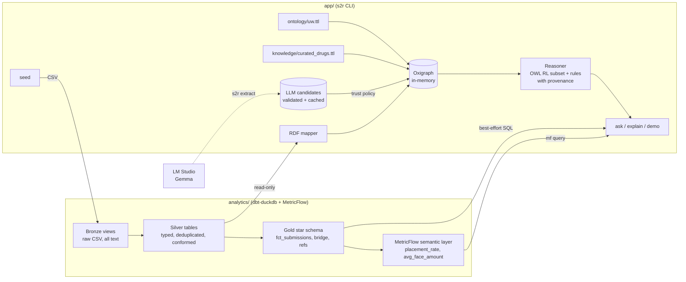

# Design: Semantic to Reasoning

## Thesis

A medallion Gold layer with a semantic layer on top gives you **business truth**: one agreed
definition of "placement rate", conformed dimensions, and numbers everyone can trust.

What it does not give you is **relationship truth**. In a star schema, relationships are join
keys. Their *meaning* (this relationship is symmetric, that one is transitive, a trust inherits
its grantor's interest, a drug implies a condition, a narrow condition implies a broad one) lives
in SQL, rewritten for every question, or nowhere at all.

A triple store with an ontology makes those meanings data. A reasoner can then **derive facts
nobody stored**, and say exactly why. This POC runs the same questions on both paths, using the
same Silver data, and shows where they agree and where they part ways.

## Scope

* Domain: life-insurance new business (illustration → submission → underwriting).
* All data is synthetic and fictional (people, companies, products, amounts).
* CLI only. There is no server, no UI, and no authentication.
* Natural-language querying is deliberately out of scope. Questions are fixed so the comparison
  stays reproducible.

## Architecture

Both paths start from the same Silver tables, so any difference in the answers comes from what
each path can represent, not from different inputs.

### Why the split between Python and Rust

* dbt + MetricFlow is the industry-standard way to build a medallion with a semantic layer. Using
  it makes the comparison fair: the Gold side is built the way a real team would build it.
* The graph, reasoner and comparison CLI are Rust: one static binary, Oxigraph embedded (no
  server, no Docker), and newtypes for validation at the edges.

### DuckDB file locking

dbt-duckdb (and therefore `mf query`) opens the warehouse read-write; `s2r` opens it read-only.
DuckDB does not allow a read-write process while another process holds the file, so `ask` and
`demo` run MetricFlow **before** opening the warehouse.

## Data

`s2r seed` generates 1,000 submissions with a fixed seed (ChaCha8; no wall-clock or UUIDs), writes
messy Bronze CSVs (mixed date formats, `$1,000,000.00`, channel aliases such as `BGA`/`DTC`,
`Y/yes/TRUE`, exact duplicate rows) and `_ground_truth.json`.

Scenarios are planted deliberately:

| Ownership (Q2) | Count | Relationship needed |
|---|---:|---|
| SELF | 874 | owner = insured |
| SPOUSE | 40 | spouse row, stored in either direction |
| PARENT / CHILD_OWNS | 20 / 12 | one `PARENT_OF` row |
| GRANDPARENT | 8 | two `PARENT_OF` rows (transitive) |
| TRUST_SELF / TRUST_SPOUSE | 10 / 6 | trust → grantor → (self or spouse) (property chain) |
| KEY_PERSON | 18 | `EMPLOYER_OF` row |
| STOLI_INVESTOR / STRANGER / TRUST | 5 / 4 / 3 | **no** interest (true positives) |

| Health (Q3/Q4) | Count | What makes it hard |
|---|---:|---|
| ND_GENERIC | 8 | generic drug name, answered "no" |
| ND_BRAND | 6 | brand name (Glucophage, Zestril) |
| ND_HIERARCHY | 6 | clopidogrel → coronary artery disease ⊑ heart disease |
| ND_LLM | 7 | Jardiance / Eliquis: only the LLM knows the brand or the indication |
| HONEST_DISCLOSED | 25 | prescription + "yes" answer |
| CARDIO_NO_QUESTION | 8 | statin → hyperlipidemia: no question, but rules out preferred |
| NOISE_RX | 30 | vitamin D, antihistamine, antidepressant, … |
| SMOKER_HONEST / HIDDEN | 12 / 7 | cotinine positive with tobacco / non-tobacco illustration |

The expected answers in the ground truth come from a small hand-written **oracle** in
`core::seed`, not from the reasoner. The test `reasoner_matches_the_independent_oracle` checks
that two independent implementations agree.

## The four questions

| | Question | Gold path | Graph path |
|---|---|---|---|
| Q1 | Placement rate and average face amount by channel × product for a quarter | MetricFlow metrics (`placement_rate` is a ratio metric) | SPARQL aggregate |
| Q2 | Which applications lack an insurable interest (possible STOLI)? | SQL: owner = insured, or a direct relationship row in either direction | Ontology + stratified negation |
| Q3 | Which "no" answers contradict prescription history? | SQL: generic-name prefix match → exact condition code → question | Property chains + condition hierarchy |
| Q4 | Which signed illustrations assume a class the case cannot get? | SQL: cotinine lab, or a "yes" to a cardiometabolic question | Rules over inferred evidence |

The Gold SQL (`app/queries/gold/*.sql`) is a fair best effort: it checks relationships in both
directions and uses the same curated dictionary as the graph (exported by `s2r seed` into
`ref_drug_condition`). Each file says what it cannot see.

Could Gold answer Q2–Q4 with recursive CTEs, a hierarchy table and an alias table? Yes, one
question at a time. At that point you have rebuilt a graph in SQL, without a place to state what
a relationship *means*, and without explanations.

### Results (seed 42, LLM candidates from Gemma 4 31B in LM Studio)

| | Gold | Graph | Gold false alarms | Gold misses |
|---|---:|---:|---|---|
| Q1 | 16 rows | 16 rows | all rows identical | |
| Q2 | 36 | 12 | 24 (GRANDPARENT 8, TRUST_SELF 10, TRUST_SPOUSE 6) | 0 |
| Q3 | 8 | 27 | 0 | 19 (ND_BRAND 6, ND_HIERARCHY 6, ND_LLM 7) |
| Q4 | 28 | 55 | 0 | 27 (implied conditions) |

The offline mock gives the same counts. Gemma mapped all three unknown pharmacy texts correctly,
proposed the right indication for empagliflozin (type 2 diabetes, 0.95) and apixaban (atrial
fibrillation, 0.90), and answered "none" for cetirizine and cholecalciferol; no answer was rejected
by the allow-lists. The cached run is in `docs/examples/llm_candidates.gemma-4-31b.json`.

With `--trust curated` (no LLM knowledge) the graph finds 20 for Q3 and 50 for Q4: the ND_LLM
cases need knowledge that only the LLM provides.

## Ontology (`app/ontology/uw.ttl`)

* Parties: `uw:Person`, `uw:Trust`, `uw:Company` ⊑ `uw:Party`.
* Insurable interest: `uw:familyMemberOf` ⊑ `uw:hasInsurableInterestIn`; `uw:spouseOf` is
  symmetric; `uw:parentOf` ⊑ `uw:ancestorOf` (transitive); `uw:childOf` is the inverse of
  `uw:parentOf`; `uw:employs` ⊑ `uw:hasInsurableInterestIn`; and
  `uw:hasInsurableInterestIn owl:propertyChainAxiom (uw:grantor uw:hasInsurableInterestIn)`.
* Medicine: `uw:indicatedCondition owl:propertyChainAxiom (uw:hasPrescription uw:prescribedDrug uw:treats)`;
  `uw:subConditionOf` is transitive; evidence of a narrow condition is evidence of every broader
  one (two more chains).
* Rate classes carry `uw:preferredTier` and `uw:tobaccoClass`.

## Reasoner (`app/src/core/reasoner.rs`)

* **Compiled OWL RL subset**: `rdfs:subClassOf`, `rdfs:subPropertyOf`, `owl:inverseOf`,
  `owl:SymmetricProperty`, `owl:TransitiveProperty`, `owl:propertyChainAxiom` are read from the
  ontology and compiled to Horn rules (24 rules for this ontology).
* **Business rules** live in `app/rules/underwriting.toml` as `when` / `filter` / `unless` / `then`
  triple patterns.
* **Evaluation**: each rule body becomes a SPARQL `SELECT`; new head triples are inserted until no
  rule adds anything (naive fixpoint; 6 iterations on the demo data, under a second).
* **Stratified negation**: `unless` (`FILTER NOT EXISTS`) is allowed only in stratum 2, which runs
  after stratum 1 has reached its fixpoint. This is a closed-world *screening* check ("we could
  not establish an interest from the facts we hold"), not OWL semantics, and the docs say so.
* **Safety**: rules are range-restricted (every head variable is bound in the body); there is a
  hard cap of 100 iterations; property chains must have 2–16 links.
* **Provenance**: every inferred triple stores its rule and premises. `explain` walks the tree
  down to asserted triples, each tagged with its origin: `silver.<table>`, `ontology`,
  `curated dictionary`, or `LLM candidate (model, confidence)`.

## LLM knowledge extraction (`s2r extract`)

The LLM (LM Studio, Gemma) is used for **one** thing: proposing knowledge the curated dictionary
lacks. It never decides an underwriting outcome.

1. Pharmacy texts that the deterministic matcher cannot map are sent to the model, which maps
   each to a catalog drug id or `null`.
2. Catalog drugs without a curated indication are sent with the allowed condition list; the model
   proposes one condition or `null`.
3. Answers must follow a JSON schema (`response_format: json_schema`, `temperature: 0`).
4. `core::knowledge::extract` validates them against allow-lists (catalog drug ids, ontology
   conditions, texts that were actually asked about). Anything else is rejected and recorded.
5. The validated candidates are cached in `data/llm_candidates.json` so demos are repeatable.
6. The **trust policy** decides what the reasoner sees: `--trust curated` ignores the LLM;
   `--trust llm --min-confidence 0.8` (default) adds candidates at or above the threshold.
7. `explain` flags any conclusion whose tree contains an LLM leaf.

## Security notes

* All data is synthetic, but it looks like health data. LM Studio runs locally by default, so
  nothing leaves the machine.
* Prompt injection: pharmacy texts go into the user message as JSON data; the system prompt says
  to treat it as data; output is schema-constrained and allow-listed; it is parsed as data only
  and never executed as SPARQL or SQL.
* No query is built from user input. SPARQL and SQL are fixed; the only interpolated values are
  a validated `Quarter` and IRIs built from validated ids.
* The warehouse is opened read-only.
* `cargo audit`: two advisories are accepted in `app/.cargo/audit.toml`.
  RUSTSEC-2026-0194 and RUSTSEC-2026-0195 (quick-xml 0.37 `NsReader` memory exhaustion) are pulled in
  by oxigraph 0.5.13, which pins that version. `s2r` never parses RDF/XML or SPARQL-XML results.
  Remove the entries when oxigraph upgrades.
* `pip-audit` on the analytics environment: no known vulnerabilities (2026-11-14).

## Testing

| Layer | What | How |
|---|---|---|
| Unit | newtypes, generator, catalog, mapper, reasoner, rules, rendering, CLI | `cargo test` (stubs for MetricFlow, LM Studio via `httpmock`, in-memory DuckDB) |
| Oracle | reasoner = independent oracle for Q2–Q4 under both trust policies | `core::questions` tests |
| Gold behaviour | Gold's misses/false alarms are exactly the planted relationship patterns | `api::cli` end-to-end test on in-memory DuckDB |
| Data | dbt tests: unique, not null, accepted values, referential integrity | `dbt build` |
| Integration | seed → real `dbt build` → real `mf query` → reasoner | `cargo test --test integration -- --ignored` |
| Live LLM | LM Studio maps brand names | `cargo test --lib -- --ignored live_` |

Line coverage: 96.5% (`cargo llvm-cov`, report in `docs/coverage/html`).

## Known limitations

* Naive (not semi-naive) evaluation: fine for tens of thousands of triples, not for millions.
* The OWL support is a pragmatic RL subset; there is no consistency checking, no `owl:sameAs`, and
  no cardinality.
* MetricFlow is pinned to dbt Core v1 (dbt-metricflow 0.15 requires it).
* The LLM step is non-deterministic across model versions; the cache file pins one run.
